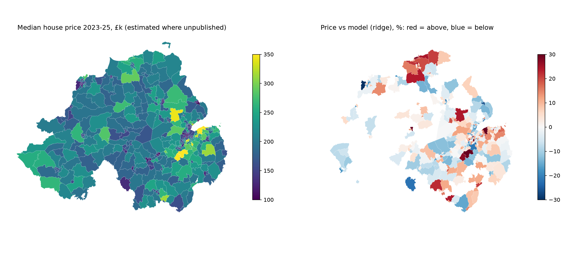

# NI Housing

Machine-learning project on Northern Ireland house prices.

## Data

`data/raw/` — NI House Price Index from Land & Property Services, taken from the quarterly
[Detailed Statistics spreadsheet](https://www.finance-ni.gov.uk/publications/ni-house-price-index-statistical-reports)
on finance-ni.gov.uk (UK Open Government Licence v3). Quarterly, Q1 2005 – Q2 2026 (86 quarters).
[OpenDataNI](https://admin.opendatani.gov.uk/dataset/nihpi-by-propertytype) carries the same series but ran a year behind.

| File | Contents |
|---|---|
| `hpi_by_property_type.csv` | Index for detached, semi-detached, terrace, apartment, and all NI |
| `hpi_by_lgd.csv` | Index + standardised price for each of the 11 council areas (LGDs) |
| `hpi_by_urban_rural.csv` | Index + standardised price, urban vs rural |

Caveat from the publisher: standardised prices are only comparable **within** a calendar year.
Use the index columns for comparisons across years.

**Revisions.** Recent quarters are revised in later releases. Comparing the Q2 2025 and Q2 2026 releases,
only the last three quarters changed (Q4 2024 by up to 0.3%, Q1 2025 0.5%, Q2 2025 2.1%); everything older was
identical. Backtests use the latest release, so for the most recent quarters they are slightly optimistic
compared with forecasting in real time. `data/vintages/2025Q2_opendatani/` keeps the older release for a true
real-time test.

`data/raw/cpi.csv` — UK CPI, all items, 2015=100 ([ONS series D7BT](https://www.ons.gov.uk/economy/inflationandpriceindices/timeseries/d7bt/mm23)),
quarterly from 1988. Used to convert the index to real (inflation-adjusted) terms.

`fetch_data.py` re-downloads everything: it finds the newest spreadsheet link on the publications page and
converts the relevant tables to the CSVs above. Both sites return 403 to non-browser user agents, so it sends a
browser `User-Agent` header.

## Run

```
python -m venv .venv
.venv\Scripts\pip install -r requirements.txt
.venv\Scripts\python fetch_data.py
.venv\Scripts\python explore.py
.venv\Scripts\python forecast.py
.venv\Scripts\python compare_windows.py
.venv\Scripts\python evaluate_new_quarters.py
.venv\Scripts\python wards.py
.venv\Scripts\python ward_model.py
.venv\Scripts\python assistant.py
.venv\Scripts\python -m pytest
```

`nihpi.py` loads the CSVs into quarterly DataFrames; `explore.py` measures the 2007 crash and recovery and writes charts to `outputs/`.

## Forecasting

`forecast.py` predicts next-quarter price growth per council area with ridge regression (features: the council's
last four quarters of growth, NI-wide growth, CPI, quarter of year). It is evaluated walk-forward: each quarter
from 2015Q1 is predicted by models trained only on earlier quarters. `test_forecast.py` (`pytest`) checks that every
feature comes from quarters before the one being predicted.

### Result 1: honest model selection, 2020–2026

`compare_windows.py` chooses ridge's training window using only 2015–2019, then scores that choice on
2020Q1–2026Q2 (286 forecasts), which the choice never saw:

| Method, holdout 2020Q1–2026Q2 | Mean abs. error (pp of quarterly growth) | vs no-change |
|---|---|---|
| Average growth over last 4 quarters | 1.94 | **+12.8%** |
| Ridge, 3-year window (chosen on 2015–19) | 2.12 | +4.8% |
| No change | 2.22 | — |
| Repeat last quarter's growth | 2.60 | −16.9% |

The window that won 2015–2019 (3 years) did worst of the windows after 2020: Covid and the 2022–23 rate rises
changed the market, and the shortest window had overfitted to the calm pre-2020 years.

### Result 2: quarters published after every modelling choice was made

`evaluate_new_quarters.py` scores 2025Q3–2026Q2, which were not available when any choice above was made.

| Method | Real-time 2025Q3 (11 forecasts, data as published then) | Walk-forward 2025Q3–2026Q2 (44 forecasts) |
|---|---|---|
| Ridge, 5-year window | 2.20 | **1.33** |
| Ridge, 3-year window | **2.08** | 1.48 |
| Average growth over last 4 quarters | 3.03 | 1.82 |
| No change | 4.34 | 2.52 |

Mean absolute error, percentage points of quarterly growth. Ridge clearly won the newest quarters; 2025Q3 was a
strong quarter (+2.5% to +7.1%) and every method under-predicted it. Four quarters is a small sample, so the
fair summary of both results is: ridge beats the naive "no change" forecast, but it does not reliably beat a
simple 4-quarter average.

### How we got here: the seasonal overshoot

Trained on all history, ridge predicted large Q2 rises and Q1 falls every year. Cause: during the
2006–12 crash Q1 growth averaged −3.7% (vs +0.3% since 2013), which the model learned as seasonality.
Restricting training to a rolling window fixed the pattern. `forecast.py` uses a 5-year window, which scores
1.64 over 2015Q1–2026Q2 (20% better than no-change), but that window was picked after seeing most of those
quarters, so that figure is optimistic. Results 1 and 2 are the honest ones.

## Neighbourhoods: what drives prices across NI's 462 wards?

Property listing sites (PropertyPal / PropertyNews) prohibit automated collection in their terms of use, so this
part uses open data only:

- **Ward prices**: annual median sale price per electoral ward, Department of Finance / LPS. Published only where
  a ward had 30+ eligible sales that year. 2023–2025 are pooled, each year brought to 2025 prices with the
  council's standardised index (the publisher advises against comparing raw medians across years), giving
  366 wards with a price; 96 have too few sales.
- **Census 2021** ward tables, NISRA: tenure, housing type, qualifications, social grade, cars, age, unemployment.
  Religion and national identity are deliberately excluded: in NI they map closely onto where people live, and a
  price model built on them would effectively price neighbourhoods by community background.
- **Ward boundaries**, OSNI: area (for population density) and centroid (for distance to Belfast City Hall).

`wards.py` downloads these (about 80 MB, not committed) and builds `data/processed/wards.csv`.
`ward_model.py` models log price and writes `outputs/ward_predictions.csv` and two charts.

| Model | Median abs. error, random 10-fold | Median abs. error, unseen council |
|---|---|---|
| Predict the average | 15.6% | 15.5% |
| Ridge regression | **7.5%** | **8.3%** |
| Gradient boosting | 7.5% | 8.3% |

"Unseen council" trains on 10 councils and predicts the 11th, a harder test because neighbouring wards are
similar. Ridge was kept: it ties gradient boosting and its coefficients can be explained.

**What drives prices** (permutation importance): the share of detached homes sold (+), residents with a degree (+),
the share of terraces sold (−), and professional/managerial households (+). Coefficients are conditional on the
other features, so correlated ones can take surprising signs (e.g. detached housing *stock* is negative once
detached *sales* are in the model).

**A bug worth knowing about.** The first version included all four tenure shares, which sum to almost 100%. Ridge
gave them huge offsetting weights and permutation importance ranked them top. Dropping one category as the
reference (owned outright; semi-detached for the sales mix) fixed it.

**Price vs model.** Each ward's out-of-fold prediction says what comparable wards elsewhere sell for. Cultra,
Ravernet, Stranmillis and Hillsborough sell 27–34% above it; Sheriff's Mountain, Curran and Inver and Woodvale
20–30% below. The gap is not "overpriced": it is everything the data cannot see (sea views, schools, prestige,
housing condition). The model also pulls the most expensive wards towards the average, so the top end is
always "above".



## Chat assistant

`assistant.py` is a command-line chat assistant (Claude, `claude-opus-5-5`) that answers questions about NI house
prices. It never answers prices from memory: it calls three tools that read this project's data and models.

| Tool | What it does |
|---|---|
| `search_wards` | Filter the 462 wards by price, council and straight-line distance to Belfast; sort by price, distance or gap vs model |
| `ward_details` | One ward: price (or labelled estimate), model prediction and gap, Census profile, council trend. Handles misspellings and names shared across councils |
| `council_trends` | Official index for a council: latest standardised price, 1- and 5-year change, vs 2007 peak in cash and after inflation, next-quarter forecast |

The system prompt tells it the limits of the data (estimates must be labelled, a gap vs the model is not
"overpriced", distance is not travel time, the forecast is rough, no property-level, rent or listing data, no
financial advice). Requests use the SDK tool runner with prompt caching, and opt into server-side refusal
fallbacks.

Needs an Anthropic API key in `ANTHROPIC_API_KEY`.

### Evaluation

`eval_assistant.py` asks 13 questions in fresh conversations and grades the answers with code. Expected answers
are computed from the data at run time, so the eval stays valid when the data is updated. It checks facts (the
right ward, council or figure appears) and behaviour: labelling estimates, caveating the forecast, explaining the
model gap without calling a ward overpriced, asking which "Abbey" is meant, and saying so when the data can't
answer (addresses, rents, buying advice). It calls the API, so it only runs with `--yes`; it prints the token
cost and saves every answer to `outputs/eval_results.json`.

`test_assistant.py` tests the tools and the graders without calling the API.
